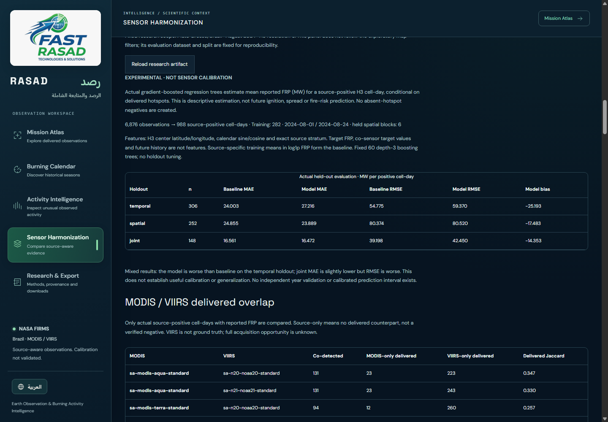

# RASAD | رصد

**Brazil-only research demonstration for NASA Space Apps: “Harmonization of MODIS and VIIRS Hot Spots.”**

RASAD brings authentic MODIS and VIIRS thermal detections onto common spatial and UTC supports while retaining sensor, platform, product, processing, confidence and uncertainty. MODIS (~1 km nominal) and VIIRS (~375 m nominal) have different detection sensitivity; adding their raw counts does not create a comparable fire-history series. Hotspots are not unique fires, perimeters or verified ignition events.

## What works

Source delivery: [aboodomari205-gif/RASAD](https://github.com/aboodomari205-gif/RASAD), branch `main`. Public source repository; application hosting/submission is separate and has not been performed.

- **Harmonized Atlas:** actual Brazil observations, source-aware filters, bounded map pages, UTC timeline and original acquisition/FRP/confidence metadata.
- **Burning Calendar:** full source-stratified historical summaries, seasonal views and descriptive prior same-month comparisons. Missing opportunity stays unknown; conditional percentiles are not validated anomalies.
- **Sensor Comparison & Trust:** common equal-area 1/2/5 km grids, H3 resolutions 4–8 with actual cell areas, delivered co-detection and source-only patterns, lineage and quality caveats.
- **Research & Export:** real source/day CSV and JSON reports, printable evidence, an actual trained conditional-FRP research prototype and reproducible held-out evaluation.

The existing five sections remain: Mission Atlas, Burning Calendar, Activity Intelligence, Sensor Harmonization, Research & Export. Arabic RTL and English LTR, mobile navigation and the original RASAD logo are retained. The four original workflows use actual detections, explicit environmental availability, detected-cell progression and descriptive evidence reports. No emergency dispatch, fire-risk probability or spread prediction is supplied.

## Real data and pilot

Indexed Brazil observations: **26,419,602** in local generation `86f1f872f7366fe4`. MODIS Terra/Aqua history spans delivered dates from 2000/2002; declared NOAA-20/21 starts in 2018/2023, with NRT through 2026-11-14. These are delivered extents, not verified acquisition coverage. NOAA-20/21 Standard lineage needs supplier clarification; no activated Brazil S-NPP history exists.

Pilot: **Mato Grosso, W −57, S −14, E −55, N −12**, EPSG:4326. August 2024 contains **6,876 real detections, 152 occupied H3 resolution-6 cells, 988 source-positive cell-days with reported FRP**. Original NASA archives and databases are preserved locally and excluded from Git. [Source/year inventory](docs/RASAD_BRAZIL_INVENTORY.md), [original input manifest](docs/RASAD_INPUT_MANIFEST.json).

## Actual experimental ML

Task: estimate **mean reported FRP MW conditional on a source-positive H3 cell-day**. It is descriptive estimation, not forecasting, sensor calibration or VIIRS-equivalent reconstruction. No absent-hotspot record becomes a negative label. No environmental feature was invented.

A deterministic Node implementation trains 60 gradient-boosted depth-3 regression trees on `log1p(mean reported FRP)`. Features are H3 center coordinates, calendar sine/cosine and exact source stratum. Baseline: per-source training mean in log space. Fixed parameters; no holdout tuning.

| Holdout | Samples | Baseline MAE MW | Model MAE MW | Baseline RMSE MW | Model RMSE MW |
|---|---:|---:|---:|---:|---:|
| Later dates, training geography | 306 | 24.003 | 27.216 | 54.775 | 59.370 |
| Unseen H3 parent blocks, earlier dates | 252 | 24.855 | 23.889 | 80.374 | 80.520 |
| Later dates AND unseen blocks | 148 | 16.561 | 16.472 | 39.198 | 42.450 |

Training: **282** positive cell-days before 2024-08-25, excluding six held-out H3 resolution-4 blocks. The four partitions total 988. **Results are mixed: temporal performance is worse than baseline; joint MAE is marginally lower but RMSE is worse.** There is no independent year validation or calibrated prediction interval. This does not establish scientific calibration or useful generalization. See [method/evaluation](docs/RASAD_RESEARCH_MODEL.md) and [machine-readable results](models/brazil-frp-evaluation.json).

## Run on Windows

Node 24+ recommended (development verified on Node 26.13.0). In PowerShell:

```powershell
npm ci
npm ci --prefix server
npm run build
npm run serve
```

Open http://localhost:4173 and enter the workspace. Development: `npm run dev` at http://localhost:5173; the Vite plugin serves the local API in the same process, so no separate backend is needed.

**Data availability matters:** the multi-GB private local index and raw deliveries are not distributed in GitHub. Full maps/history require importing the original delivered FIRMS files with `npm run import:south-america`, then `npm run prepare:data`. Despite the legacy script names, active application/API scope is Brazil only. Python numpy/shapely are required for original-file import; they are not required for model replay. See [import documentation](docs/SOUTH_AMERICA_IMPORT_REPORT.md).

The small committed `models/brazil-pilot-samples.json` contains actual derived source-positive cell-day labels, not original hotspot positions or a complete Brazil archive. It supports reproducible model training without the private database:

```powershell
node scripts/train-research.mjs --from-bundled
```

To rebuild labels from the original indexed records instead:

```powershell
npm run train:research
```

Both use fixed dates, H3 support, split and hyperparameters. Sample SHA256: `aec28403fca1756c6e230bdeb18e34e3c407031d7e421d389822c58d5a6e59f8`. The research panel/API can show the committed real model without the full archive, explicitly reporting archive availability; it never supplies fabricated map observations.

## Two-minute demonstration

1. Enter **Mission Atlas**, inspect Brazil, switch MODIS/VIIRS and review actual UTC/FRP/confidence.
2. Open **Sensor Harmonization**: read the fixed August 2024 Research Prototype, source-pair overlap and mixed held-out results. Select an actual held-out example; observed and estimated FRP are labeled separately.
3. In the Mato Grosso pilot choose **Inspect August 2024 pilot**, change H3 resolution and inspect source-separated cell/day evidence.
4. Open **Activity Intelligence**, play daily occupied cells and select a UTC day. This is detected activity, not perimeter growth.
5. Open **Burning Calendar**, inspect authentic history and qualified same-month comparisons.
6. Export pilot CSV/JSON and the research evaluation JSON; print the report with limitations.

## Status and missing evidence

| Component | Status |
|---|---|
| Brazil Atlas, common grids/H3, calendar, source trust, exports | DONE for delivered observations |
| Cross-sensor co-detection / source-only analysis | DONE descriptive; not opportunity-normalized |
| Real conditional-on-detection ML | EXPERIMENTAL; actual artifacts, held-outs and bounded inference |
| Environmental point import/context | PARTIAL; actual raster inputs/extraction runtime missing |
| Opportunity-normalized calibration / validated anomaly | BLOCKED: full fire masks, valid-pixel/cloud QA, geolocation, independent validation |
| AI downscaling / historical reconstruction | NOT VALIDATED; no modeled historical hotspot maps |
| Full public hosting / submission | Not performed; GitHub delivery is separate from deployment |

[Smallest missing-data checklist](docs/RASAD_BRAZIL_MISSING_CHECKLIST.md) specifies one pilot bbox/month, exact products, official links, folders and authentication. Do not download all Brazil. Store credentials only in ignored local configuration; never commit them.

## Verification and screenshots

```powershell
npm test
npm run build
npm run lint
npm run verify:release
$env:RASAD_TEST_ORIGIN='http://localhost:4173'
node scripts/verify-rasad-batch1-browser.mjs
node scripts/verify-rasad-batch1-browser.mjs --research
node scripts/verify-rasad-batch1-browser.mjs --pilot
```

Chrome browser verification currently uses the Windows Chrome path in the harness. Original-data integration tests skip when the private index is absent; that is not a passed original-data validation. Real model labels/artifact tests remain reproducible. [Current release evidence](docs/RASAD_AI_DELIVERY_REPORT.md).



[Atlas screenshot](docs/screenshots/mission-atlas.png) · [Calendar](docs/screenshots/burning-calendar.png) · [Arabic mobile research panel](docs/screenshots/research-arabic-mobile.png)

No NASA endorsement, calibrated sensor equivalence, verified no-fire coverage or validated prediction is claimed. No paid service or public application deployment was performed.
