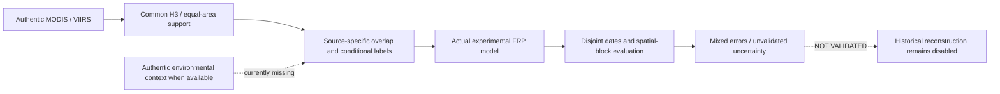

# Conditional-on-detection FRP research prototype

This **actual trained model** supersedes older reports saying that no ML implementation exists. It does **not** supersede their calibration/downscaling/reconstruction blockers. Status: **EXPERIMENTAL_NOT_CALIBRATION**.

## Scientific target and source support

Input: real Brazil FIRMS records from generation `86f1f872f7366fe4`, bounded to Mato Grosso `[-57,-14,-55,-12]`, 2024-08-01–2024-08-31 UTC. The indexed query reads existing compressed observation chunks; it neither scans every Brazilian record nor re-ingests the archive. Four exact strata are retained: Aqua/Terra MODIS Standard and delivered NOAA-20/21 VIIRS Standard. NOAA-20/21 lineage is supplier-declared and unresolved; these records cannot establish validated calibration.

Group by exact dataset ID, H3 resolution-6 cell and UTC day. Count detections and reported nonnegative finite FRP; exclude groups without reported FRP. Target is arithmetic **mean reported FRP MW in each source-positive cell-day**, not total energy, cell fire intensity, ignition probability or a future outcome. Real FRP zero remains zero. The selected actual delivery has 6,876 records, no missing FRP, and 988 labeled source-cell-days. The original native confidence and source metadata remain in the archive/API; they are not converted into common confidence scores.

No absent-hotspot day is made into a label, including a negative or a verified zero. Consequently the task is conditional on observed detection, selected by sensor sensitivity, viewing conditions, cloud and processing. This selection bias is not corrected. Mean FRP also depends on the source's sample composition, pixel footprint and detection threshold. It is not physically sensor-neutral.

## Model and baseline

Features: H3 center latitude/longitude, sine/cosine of fractional day within the actual UTC year, exact source index. The source index is a deterministic encoding of the preserved dataset IDs, not a calibration coefficient or a claim that IDs have physical order. No FRP target, counterpart sensor FRP, contemporaneous target count or future record is a feature. There are no environmental covariates because no authentic environmental inputs are available.

Fit `log1p(targetMW)` by squared-error gradient boosting: initial global training mean; 60 regression trees, depth at most 3, minimum leaf 12, learning rate 0.06. Each tree fits training residuals using deterministic feature/threshold squared-error minimization. Back-transform with `expm1`, clamp the estimate to nonnegative MW. This back-transform is not a bias-corrected conditional arithmetic expectation; held-out bias and MW errors reveal its limitations. Baseline uses the exact-source training mean in the same log target. All sources must have actual training support.

No hyperparameter optimization or favorable-result selection was performed. The first split attempt used a hash-modulo spatial rule that produced no joint held-out rows and **did not train a model**. It was replaced, before fitting/evaluation, by a fixed rank-by-hash 20% block holdout (six of 28 unique resolution-4 parents); selection uses geography, not FRP values. Only one actual fitted model/evaluation was produced. The old failed attempt is not a success claim.

## Leakage and holdouts

Chronological cutoff: **2024-08-25**. All earlier dates in non-held blocks train the model. Geographic block: H3 resolution-4 parent of each resolution-6 cell; all sources in a held block are excluded from training. Blocks are deterministically sorted by FNV-1a hash, then the first `ceil(n/5)` are held out. Block membership is chosen from observed geography without using target values. Train/test cell IDs and block boundaries do not overlap in spatial holdouts. Adjacent blocks may remain spatially correlated; this is not buffered spatial independence.

| Partition | Dates | Geography | Samples |
|---|---|---|---:|
| Training | August 1–24 | Non-held blocks | 282 |
| Temporal evaluation | August 25–31 | Non-held blocks | 306 |
| Spatial evaluation | August 1–24 | Held blocks | 252 |
| Joint evaluation | August 25–31 | Held blocks | 148 |

The same earlier dates can occur in training and the spatial-only evaluation, intentionally. Only the joint evaluation tests later dates **and** disjoint blocks simultaneously. This is one month in one pilot, not a held-out year or independent operational validation. Sources are represented in training; unknown sources are rejected.

## Actual evaluation

| Holdout | Baseline MAE MW | ML MAE MW | Baseline RMSE MW | ML RMSE MW | ML bias MW | Baseline / ML MAE log1p |
|---|---:|---:|---:|---:|---:|---|
| Temporal, n=306 | 24.002715 | 27.216127 | 54.775235 | 59.370070 | −25.192934 | 0.810607 / 0.985047 |
| Spatial, n=252 | 24.854669 | 23.888643 | 80.373585 | 80.520142 | −17.483089 | 0.802865 / 0.772969 |
| Joint, n=148 | 16.560838 | 16.471782 | 39.198461 | 42.449629 | −14.353120 | 0.750879 / 0.780961 |

The model is worse on temporal metrics and joint RMSE/log error. A small improvement in joint MAE does not prove useful generalization. No calibrated uncertainty interval or accuracy percentage is provided. Evaluation JSON retains full precision and baseline bias as well.

## Cross-sensor comparison, not calibration

Retain exact MODIS/VIIRS dataset pairs on common H3/day support. Compute source-positive counts, co-detected cell-days, source-only delivered cell-days and delivered Jaccard. Retain per-pair observed counts and mean FRP values in the JSON. Same UTC day and H3 cell does **not** mean the same acquisition, physical fire event or matched opportunity.

| Exact source pair | Co-detected cell-days | MODIS-only delivered | VIIRS-only delivered | Delivered Jaccard |
|---|---:|---:|---:|---:|
| Aqua / NOAA-20 | 131 | 23 | 223 | 0.347480 |
| Aqua / NOAA-21 | 131 | 23 | 243 | 0.329975 |
| Terra / NOAA-20 | 94 | 12 | 260 | 0.256831 |
| Terra / NOAA-21 | 96 | 10 | 278 | 0.250000 |

These are detection-only conditional patterns, not false positives/negatives, recall, sensitivity, accuracy or an opportunity-normalized calibration. VIIRS is not ground truth. A supervised sensor-adjustment model was not fitted because the required full masks and matched valid observation opportunities are absent.

## Reproduction and inference

`npm run train:research` derives support from the real local indexed rows. `node scripts/train-research.mjs --from-bundled` replays the exact committed real derived samples without the multi-GB database. The latter verifies SHA256 before fitting. Small artifact files:

- `models/brazil-pilot-samples.json`: actual 988 derived labeled cell-days, exact source descriptors, generation and checksum. Not raw hotspot positions or all Brazil history.
- `models/brazil-frp-model.json`: actual tree parameters, baseline, fixed domain, evaluation, 30 actual joint-holdout examples.
- `models/brazil-frp-evaluation.json`: actual full-precision metrics, pairwise co-detection evidence, limitations.

Sample SHA256: `aec28403fca1756c6e230bdeb18e34e3c407031d7e421d389822c58d5a6e59f8`.

`GET /api/research/prototype` returns the actual artifact summary and labeled examples. `?example=0` through `29` bounds inference to an actual held-out example, and returns observed and estimated FRP in separate fields. Other arguments/countries/indices are rejected; no arbitrary map, date or retrospective hotspot generator exists. If a local activated generation differs from the artifact, inference is refused as stale. If the full index is absent, the fixed committed research artifact can be inspected with `archiveAvailable:false`; it does not stand in for map observations.

The UI scientific pipeline is:

## Remaining evidence

Full MOD14/MYD14 C6.1 masks, MOD03/MYD03 geolocation and valid-pixel/cloud QA; VIIRS VNP14IMG/VJ114IMG/VJ214IMG C2 full masks with matching geolocation and QA, including no-fire overpasses; real environmental features; source-lineage reconciliation; independent temporal years and geographic validation. See [exact pilot delivery checklist](RASAD_BRAZIL_MISSING_CHECKLIST.md). AI-guided downscaling and VIIRS-like reconstruction remain **NOT VALIDATED** and do not produce maps.
